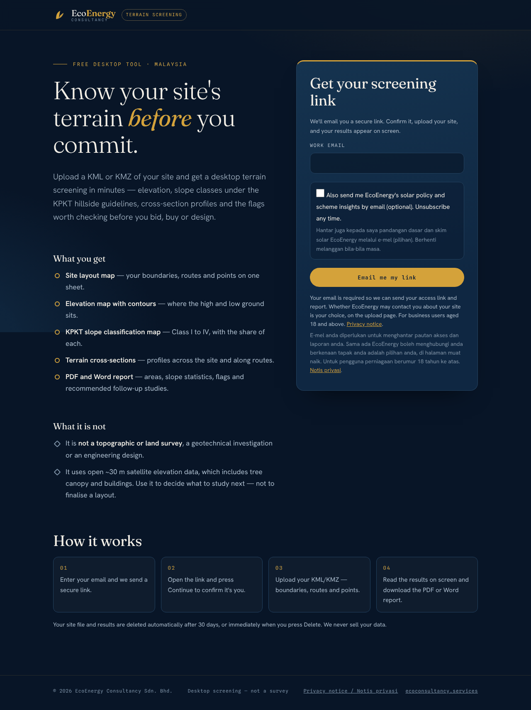
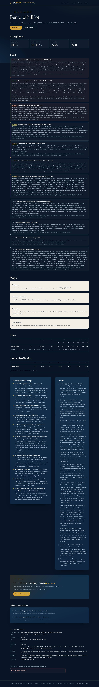

# EcoEnergy terrain screening tool — owner's guide

A free lead-magnet web tool for EcoEnergy Consultancy. A visitor confirms their email
address through a magic link, uploads a KML/KMZ of a site in Malaysia, and gets a desktop
terrain screening on screen and as PDF and Word reports: area, elevation, slope classes
under the KPKT hill-land guideline, cross-section profiles, rule-based regulatory flags and
recommended follow-up studies. Each report ends with a "Book a free consult" call to action,
and the admin pages show who used the tool, from which channel, and whether they agreed to
be contacted about their site.

**What it is not.** It is not a topographic or land survey, a geotechnical investigation,
an EIA or an engineering design. Elevations come from a ~30 m satellite surface model
(Copernicus DEM GLO-30, a DSM that includes tree canopy and buildings, acquired 2010–2015),
so the output is screening-grade: it tells a developer what to study next, not what to
build. It is also not a CRM or newsletter sender: it records consent and exports lists.

- Sample outputs, no setup needed: [`docs/samples/`](docs/samples/)
- Screenshots of every page: [`docs/screenshots/`](docs/screenshots/)
- Module contract, `result.json` schema, consent model and security rules:
  [`docs/ARCHITECTURE.md`](docs/ARCHITECTURE.md)

| Landing | Result (Pahang hill site, LSS) |
|---|---|
|  |  |

## Quick start

The machine running the tool needs internet access: elevations are read from the public
Copernicus DEM tiles on Amazon Web Services at run time.

### macOS / Linux

Needs Python 3.11 or newer.

```bash
cd terrain-tool
./run_local.sh
```

### Windows (PowerShell)

Needs Python 3.11 or newer (the `py` launcher). Windows blocks scripts by default, so start
it through PowerShell with a one-off bypass:

```powershell
cd terrain-tool
powershell -ExecutionPolicy Bypass -File .\run_local.ps1
```

Both scripts create `.venv`, install `requirements.txt` (preferring ready-built wheels), copy
`.env.example` to `.env` on first run and start the app on http://localhost:8000 (set `PORT`
to use another port; email links follow it). Emails are not sent in this mode:
they land in the development inbox at http://localhost:8000/dev/outbox.

### Docker

```bash
cd terrain-tool
cp .env.example .env          # optional: set ADMIN_PASSWORD here to open /admin
docker compose up --build
```

This starts the app on http://localhost:8000 together with
[Mailpit](https://mailpit.axllent.org/), a local mail catcher: magic-link and report-ready
emails arrive at **http://localhost:8025**, exactly as a visitor would receive them. Both are
published on this machine's loopback only (the inbox holds every magic link). Data lives in
the `terrain-data` Docker volume (`docker compose down -v` deletes it).

## A two-minute walkthrough

Three example sites ship in `tests/fixtures/`:
`hilly_site_pahang.kml` (hill land near Bentong), `flat_site_kedah.kml` (flat paddy with a
cable route) and `fpv_pond_perak.kml` (a former mining pond, for floating solar).

1. **Landing** — open http://localhost:8000, enter any email address (e.g.
   `you@example.com`). The newsletter box is optional and unticked. Press
   **Email me my link**.
2. **Dev inbox** — open http://localhost:8000/dev/outbox (or Mailpit at
   http://localhost:8025 with Docker) and click the link in *Your terrain screening link*.
3. **Continue** — press **Continue to upload your site**. (The link page never signs you
   in by itself, so email scanners that open links can't use it up.)
4. **Upload** — choose `tests/fixtures/hilly_site_pahang.kml`, pick scheme *Large Scale
   Solar (LSS)*, and decide whether to tick *EcoEnergy staff may email me about this site
   (optional)*. Press **Run terrain screening**.
5. **Result** — after a few seconds the page shows the four maps, the at-a-glance numbers,
   the flags (for this site: KPKT slope classes, the EIA Order slope item, Pahang's solar
   slope rule), the tables, follow-ups and caveats. The **Follow-up about this site** card
   shows your choice with a one-click change.
6. **PDF / Word** — use **Download PDF** and **Download Word**.
7. **Admin** — set `ADMIN_PASSWORD=` in `.env`, restart, open
   http://localhost:8000/admin/leads (user `admin`). Each screening shows Follow-up
   **Yes** or **No** with a *Do not contact* badge; **Leads CSV** contains only the
   screenings whose follow-up consent is currently granted.
8. **Account** — open **Account** in the header: what we hold, follow-up per report,
   newsletter on/off, the consent history, **Download my data (JSON)** and
   **Delete my account and data**.

## Configuration

Settings come from environment variables or `.env` (real environment variables win).
Every field of `app/config.py:Settings` is listed here and in `.env.example` with its
default; `tests/test_flow.py` fails if one is missing. In `.env`, put comments on their own
line: everything after `=` is the value.

| Variable | Default | Meaning |
|---|---|---|
| **core** | | |
| `APP_ENV` | `development` | `development` or `production`. Production refuses to start without `SECRET_KEY` and with `MAIL_BACKEND=outbox`. |
| `BASE_URL` | `http://localhost:8000` | Public origin used in email links and the Origin check on form posts. Use `https://` in production (cookies become Secure). Left unset, `python -m app` uses `http://localhost:$PORT`. |
| `SECRET_KEY` | *(empty)* | Signing key for unsubscribe links. Empty in development: generated into `DATA_DIR/.secret_key`. Required in production. |
| `DATA_DIR` | `./data` | Folder for the SQLite database (`app.db`) and job files. Relative paths count from where the app is started. |
| `TRUST_PROXY_HEADERS` | `false` | Take the client IP from `X-Forwarded-For`. Set `true` only behind your own reverse proxy, and only if it appends the address it received the request from (nginx `$proxy_add_x_forwarded_for`, AWS ALB, Cloudflare) or overwrites the header — never if it passes a client-supplied header on unchanged. |
| `TRUSTED_PROXY_HOPS` | `1` | How many of your proxies append to `X-Forwarded-For` (e.g. `2` for Cloudflare in front of nginx). The client IP is taken that many hops from the right; the left-most hops can be forged by the client. |
| **privacy notice** | | |
| `NOTICE_VERSION` | `2026-10-draft-3` | Version stored with every consent record. Bump it whenever the privacy notice changes. |
| **email** | | |
| `MAIL_BACKEND` | `outbox` | `outbox` (development: mail is stored and shown at `/dev/outbox`), `smtp`, or `ses` (Amazon SES v2 API; `pip install boto3`). |
| `MAIL_FROM` | `EcoEnergy Consultancy <no-reply@ecoconsultancy.services>` | From header of every email. |
| `MAIL_REPLY_TO` | `contact@ecoconsultancy.services` | Reply-To header; replies and personal data requests go here. |
| `SMTP_HOST` | `localhost` | SMTP server when `MAIL_BACKEND=smtp` (Mailpit in Docker: `mailpit`). |
| `SMTP_PORT` | `1025` | SMTP port. `465` = implicit TLS; `587` normally with `SMTP_STARTTLS=true`. |
| `SMTP_USER` | *(empty)* | SMTP login user; empty = no login. |
| `SMTP_PASSWORD` | *(empty)* | SMTP password. |
| `SMTP_STARTTLS` | `false` | Upgrade the SMTP connection with STARTTLS (ignored on port 465). |
| `SES_REGION` | `ap-southeast-5` | Region for `MAIL_BACKEND=ses`. AWS credentials come from the standard AWS chain (env vars, profile or instance role). |
| **magic links and sessions** | | |
| `TOKEN_TTL_HOURS` | `72` | Hours a magic link stays valid. |
| `TOKEN_MAX_USES` | `5` | How many times one magic link can be used (scanners never use it up: `GET /start` is read-only). |
| `SESSION_TTL_HOURS` | `24` | Hours a sign-in session lasts. |
| **retention (PDPA)** | | |
| `RETENTION_DAYS` | `30` | Days before a site file, its results and reports are deleted (follow-up about that site ends with it). |
| `UNVERIFIED_PURGE_DAYS` | `7` | Days before an email address that was never confirmed is deleted. |
| `INACTIVE_PURGE_DAYS` | `730` | Days without activity after which a confirmed account with no report left and no newsletter subscription is deleted (a one-way hash of the address is kept so it is not contacted). |
| **abuse controls** | | |
| `RATE_LINK_PER_EMAIL_HOUR` | `3` | Magic-link requests per email address per hour. |
| `RATE_LINK_PER_IP_HOUR` | `10` | Magic-link requests per IP address per hour. |
| `RATE_JOBS_PER_EMAIL_DAY` | `3` | Screenings per email address per day. |
| `RATE_JOBS_PER_IP_DAY` | `10` | Screenings per IP address per day. |
| `TURNSTILE_SITE_KEY` | *(empty)* | Cloudflare Turnstile site key. The human check (and the Cloudflare script on the landing page) is on when this is set; sign-ups are refused until `TURNSTILE_SECRET_KEY` is also set. |
| `TURNSTILE_SECRET_KEY` | *(empty)* | Cloudflare Turnstile secret key. |
| **upload limits** | | |
| `MAX_UPLOAD_MB` | `5.0` | Largest KML/KMZ upload, in MB. |
| `MAX_KMZ_UNCOMPRESSED_MB` | `20.0` | Largest uncompressed KML inside a KMZ, in MB. |
| `MAX_FEATURES` | `50` | Most placemarks (polygons, lines, points) in one file. |
| `MAX_EXTENT_KM` | `15.0` | Largest site extent (bounding-box width or height), in km. |
| **terrain engine** | | |
| `DEM_PROVIDER` | `copernicus` | `copernicus` (reads 1° tiles from AWS by name and byte range; no coordinates sent), `opentopodata` (fallback; sends site coordinates) or `geotiff` (local file). |
| `DEM_GEOTIFF_PATH` | *(empty)* | GeoTIFF or VRT in EPSG:4326, used when `DEM_PROVIDER=geotiff`. |
| `COPERNICUS_BASE_URL` | `https://copernicus-dem-30m.s3.amazonaws.com` | Base URL of the public Copernicus DEM GLO-30 bucket. |
| `OPENTOPODATA_URL` | `https://api.opentopodata.org/v1` | OpenTopoData API base URL (`DEM_PROVIDER=opentopodata`). |
| `OPENTOPODATA_DATASET` | `srtm30m` | OpenTopoData dataset name. |
| `MAX_GRID_CELLS` | `400000` | Cap on DEM cells analysed per job; larger areas are decimated. |
| `CONTOUR_MIN_INTERVAL_M` | `5.0` | Never draw contours finer than this, in metres. |
| **worker** | | |
| `WORKER_INLINE` | `true` | Run the job worker as a thread inside the web process (single process). Keep `true`: with `false` nothing processes uploads or runs the retention sweeps (the tests use it). |
| `WORKER_POLL_SECONDS` | `1.0` | Seconds between queue polls when idle. |
| **admin** | | |
| `ADMIN_USER` | `admin` | HTTP Basic user for `/admin`. |
| `ADMIN_PASSWORD` | *(empty)* | Password for `/admin`. Admin pages are disabled (404) while it is empty. |
| **links** | | |
| `CONSULT_URL` | `https://www.ecoconsultancy.services/consult/` | Target of the "Book a free consult" button (utm tags are added). |
| `SITE_URL` | `https://www.ecoconsultancy.services/` | Marketing site linked from the header and emails. |
| **process** (not in Settings; environment or `.env`) | | |
| `HOST` | `127.0.0.1` | Listen address (`0.0.0.0` in the Docker image). |
| `PORT` | `8000` | Listen port. |
| `LOG_LEVEL` | `INFO` | Log level. |

Production needs at least `APP_ENV=production`, a long random `SECRET_KEY`,
`MAIL_BACKEND=smtp` with SMTP settings, an `https://` `BASE_URL` and an `ADMIN_PASSWORD`.

## How it works

```
browser ──▶ FastAPI app (app/main.py) ──▶ SQLite (DATA_DIR/app.db) + job files (DATA_DIR/jobs/<id>/)
                │                             ▲
                │ enqueue                     │ result.json, PNGs, report.pdf, report.docx
                ▼                             │
           worker thread (app/jobs.py) ──▶ app.terrain.run_screening ──▶ Copernicus DEM tiles (AWS, HTTPS)
                                       └─▶ app.reports.build_reports (ReportLab + python-docx)
```

- **Web app** (`app/main.py`, `app/security.py`): magic links (only sha256 hashes stored),
  sessions with CSRF tokens, rate limits, strict security headers, an optional Cloudflare
  Turnstile check, and the account self-service pages. Admin pages (`app/admin.py`) use
  HTTP Basic.
- **Jobs** (`app/jobs.py`): one worker thread inside the web process claims queued jobs
  from the `jobs` table, runs the engine and the renderers, emails a fresh link when the
  report is ready, and sweeps expired data every 10 minutes.
- **Engine** (`app/terrain/`): safe KML/KMZ parsing, DEM sampling, slope and KPKT classes
  inside each polygon, profiles, four matplotlib figures, the DOSM state/district lookup,
  and rule-based flags whose wording all lives in `app/terrain/flags.py`. No KML text is
  ever sent to an LLM.
- **Reports** (`app/reports/`): one content model rendered to PDF and Word.
- **Database**: started fresh or upgraded in place on every start (`init_db` adds missing
  columns), so an existing `data/app.db` keeps working after an update.

The full contract — module interfaces, `result.json` schema, consent model, security
rules and tests — is in [`docs/ARCHITECTURE.md`](docs/ARCHITECTURE.md).

## Data sources and licences

**Elevation: Copernicus DEM GLO-30 ("Copernicus WorldDEM-30").** Read as Cloud-Optimised
GeoTIFF tiles (1° × 1°, 2021 release) from the public `copernicus-dem-30m` bucket on the
Registry of Open Data on AWS. The server requests a tile by its 1° name and reads only the
parts of the file covering the site's general area (byte ranges of an internal block of
roughly 30 km); the site's coordinates, file and the visitor's details never leave the server. The *Licence for the use of the Copernicus WorldDEM-30* is
free of charge, worldwide and contains no non-commercial restriction. It requires the
following; the tool prints the first two in every report and on the result page:

- the notice for derived products (slope maps, contours, profiles): *"produced using
  Copernicus WorldDEM-30 © DLR e.V. 2010-2014 and © Airbus Defence and Space GmbH 2014-2018
  provided under COPERNICUS by the European Union and ESA; all rights reserved"*;
- the disclaimer: *"The organisations in charge of the Copernicus programme by law or by
  delegation do not incur any liability for any use of the Copernicus WorldDEM-30"*;
- no suggestion of endorsement by the Copernicus entities, and the same obligations passed
  on to anyone the data is distributed to.

**Fallback elevation: OpenTopoData** (`DEM_PROVIDER=opentopodata`) serves SRTM 1 arc-second
(NASA/USGS, February 2000). It sends the site's sample coordinates to api.opentopodata.org;
the result page and the privacy notice say so when it is in use. The public API allows
100 locations per request, 1 call per second and 1,000 calls per day, so it is for
emergencies, not production: the tool samples at most 1,000 points per site, so over sites
larger than about 1.5 km the grid is coarser than 60 m, slope shares are understated and
the report carries a `coarse_grid` caution instead of an "all Class I" reading.

**State and district boundaries: Department of Statistics Malaysia (DOSM)**,
`administrative_2_district.geojson` from
[github.com/dosm-malaysia/data-open](https://github.com/dosm-malaysia/data-open)
(160 districts with their state). Its Open Data License allows copying, publishing,
adapting and exploiting the data commercially; you must not use it in a way that suggests
official status or DOSM endorsement, and it is provided "as is". The licence has no
explicit attribution clause, but every report credits DOSM and says no endorsement is
implied. The dataset does not state its as-of date. (These replace the geoBoundaries files
used in the first model, whose district layer had an unresolved licence question.)

**Fonts** load from Google Fonts (the visitor's browser contacts Google); see the
checklist below.

## Privacy (PDPA) design

Built against the Personal Data Protection Act 2010 (as amended by Act A1727) and the PDP
Regulations 2013. The privacy notice at `/privacy` is a **draft for legal review** (EN + BM,
version `NOTICE_VERSION`).

- **Unbundled consents.** The landing form asks only for the email address needed to send
  the link and report. The newsletter has its own unticked box. Staff follow-up about a
  site is a separate, unticked box on the upload page, stored per report and changeable
  per report on the result page and the account page (withdrawal takes effect at once).
  Each consent request is visually separate from the rest of the form (reg 3(2)); the
  notice is not used to collect consent.
- **Consent ledger.** Append-only rows with the exact EN/BM wording shown, notice version,
  time, IP and browser, so consent can be proved (reg 3(1), reg 3(5)).
- **Double opt-in** for the newsletter: it becomes active only when the link emailed with
  that opt-in is used (any other sign-in, or a tick typed in by someone else, confirms
  nothing). One-click unsubscribe (RFC 8058) is ready for newsletter mail; unsubscribe links
  are signed for the subscriber id and the address together.
- **Retention.** Site files, results and reports (and the answers given with them):
  `RETENTION_DAYS` (30) or at once with Delete. Never-confirmed addresses:
  `UNVERIFIED_PURGE_DAYS` (7). Confirmed accounts with no report left, no newsletter and no
  activity: `INACTIVE_PURGE_DAYS` (730). Abuse counters: 2 days. SQLite runs with
  `secure_delete` on, so erased rows are overwritten in `app.db`.
- **Written requests.** Someone who withdraws consent or objects to direct marketing by email
  (s.38, s.43) is recorded with `python -m app.manage withdraw EMAIL --followup --newsletter
  --note "Email of 12 Oct 2026"`: follow-up ends for every live report, the newsletter is
  unsubscribed, and the ledger gets a `withdrawn` row with the note. For the newsletter alone,
  the `unsubscribe_url` column of the newsletter CSV does the same.
- **Self-service rights.** `/account` shows everything held, exports it as JSON, and
  deletes the account; erasure leaves only sha256(email) in a suppression list so the
  person is not contacted again (a new sign-up lifts it).
- **Minimal sharing.** Admin exports are limited by consent: the leads CSV holds only
  screenings with follow-up granted; the newsletter CSV only confirmed subscribers.
- **Age.** The landing page and notice say the tool is for business users aged 18 and
  above (reg 3(3) requires parental consent for under-18s).

**Still needs legal review** (placeholders in `/privacy` are in [square brackets]):

- contact person's designation (reg 4 requires a designation and phone number), company
  registration number, publication date, and which language version prevails;
- the hosting and email providers, the countries they process data in, and the s.129
  basis for each transfer (a transfer impact assessment, contract, or contractual clauses),
  with the records the Cross Border Personal Data Transfer guideline asks for;
- how long consent records and the email address are kept after an account is erased
  (reg 3(5) puts the burden of proving consent on the data user);
- whether staff follow-up counts as direct marketing under s.43 (the tool already treats
  it as a separate opt-in);
- whether a Data Protection Officer must be appointed (the DPO guideline's thresholds
  include more than 20,000 data subjects, or regular and systematic monitoring) and, if so,
  publishing the DPO's business contact details in the notice;
- not checked: registration as a data user/controller, data-access fees, and how the
  Personal Data Protection Standard 2015 retention rules apply to a web form.

Do not state a response deadline for data portability requests: no period has been
prescribed under s.43A(3) yet.

## Before going live

- [ ] **Domain and HTTPS.** A subdomain (e.g. `tools.ecoconsultancy.services`, your choice)
      behind a TLS-terminating reverse proxy; `BASE_URL=https://…`, `APP_ENV=production`,
      `TRUST_PROXY_HEADERS=true` only if the proxy appends to (or overwrites)
      `X-Forwarded-For`, with `TRUSTED_PROXY_HOPS` set to the number of such proxies.
- [ ] **Email.** To keep processing in Malaysia use Amazon SES in `ap-southeast-5`
      (Asia Pacific, Malaysia; available since 21 Nov 2025). AWS lists **no SES SMTP
      endpoint in that region**, only the HTTPS API, so set `MAIL_BACKEND=ses`,
      `SES_REGION=ap-southeast-5` and `pip install boto3`. Any other provider works over
      `MAIL_BACKEND=smtp` (`SMTP_PORT=587` + `SMTP_STARTTLS=true`, or port 465), but a
      provider outside Malaysia is a cross-border transfer (PDPA s.129).
- [ ] **SPF, DKIM and DMARC** for the sending domain in `MAIL_FROM`, then send yourself a
      test link and check it lands in the inbox (Gmail and Outlook).
- [ ] **Cloudflare Turnstile** keys (`TURNSTILE_SITE_KEY`, `TURNSTILE_SECRET_KEY`).
- [ ] **`ADMIN_PASSWORD`** — long and unique; share it only with staff who handle leads.
- [ ] **`SECRET_KEY`** — long and random (`python -c "import secrets; print(secrets.token_urlsafe(48))"`),
      kept out of git.
- [ ] **Backups** of `DATA_DIR` (the SQLite file with WAL; use `sqlite3 app.db ".backup …"`),
      encrypted, with a tested restore and the same retention as the data.
- [ ] **One instance only** with SQLite and the inline worker. Before running more than one
      app instance, move to Postgres (the schema avoids SQLite-only types) and run the
      worker as a separate process.
- [ ] **Monitoring**: uptime check on `/healthz`, alerts on error logs and failed jobs,
      disk space for `DATA_DIR`.
- [ ] **Legal review** of the privacy notice (fill every bracketed item, bump
      `NOTICE_VERSION`), a **DPO assessment**, and a **transfer impact assessment** for any
      provider outside Malaysia; a breach-response plan (a breach likely to cause significant
      harm must be notified to the Commissioner within 72 hours).
- [ ] **Fonts**: consider self-hosting the three typefaces so visitors' browsers do not
      contact Google (then remove the Google Fonts line from the notice and the CSP).
- [ ] **Posting**: share on LinkedIn and Threads with utm tags so the admin channel table
      works, e.g. `https://<your-domain>/?utm_source=linkedin&utm_medium=social&utm_campaign=terrain_tool`
      and `…utm_source=threads…`.
- [ ] **Embed the CTA on the static site** (`index.html`, the consult page, relevant
      insights articles), e.g.
      `<a class="btn" href="https://<your-domain>/?utm_source=website&utm_medium=cta&utm_campaign=terrain_tool">Screen your site's terrain — free</a>`.

## Known limitations

- **Surface model, not ground.** GLO-30 is a DSM: in plantations and forest, slopes and
  elevations include the canopy. ~30 m cells understate short steep slopes, drains and
  bunds. Water bodies and recent earthworks show the 2010–2015 surface.
- **Boundaries** are DOSM districts (no local-authority/PBT boundaries; no open national
  dataset of those was found). Points offshore fall back to the nearest district within
  5 km, otherwise no state is shown and state rules are not applied.
- **Flags are rule-based screening prompts**, not legal advice; thresholds and wording live
  in `app/terrain/flags.py` with their sources.
- **Single process.** SQLite + one worker thread: jobs run one at a time (typically seconds;
  longer when tiles download slowly from the AWS bucket, which is in `eu-central-1`).
- **Rate limits per IP** may bite in offices behind one NAT address; adjust `RATE_*`.
- **Admin** is a single HTTP Basic account with no audit trail of who exported what.
- **No newsletter sending, bounce or complaint handling**: the tool records consent and
  exports confirmed subscribers for your mailing tool.
- **No malware scanning** of uploads (KML/KMZ are parsed defensively and never executed).
- The privacy notice is a draft; see *Still needs legal review*.

## Tests

```bash
python -m pip install --prefer-binary -r requirements-dev.txt
python -m pytest -q
```

The suite runs offline (the web tests use a fake engine; the integration tests use a
synthetic GeoTIFF). To also fetch real Copernicus tiles:
`RUN_NETWORK_TESTS=1 python -m pytest -q -m network`. Behind a TLS-intercepting proxy, point
`CURL_CA_BUNDLE` and `REQUESTS_CA_BUNDLE` at its CA bundle in your shell — never in the app.
