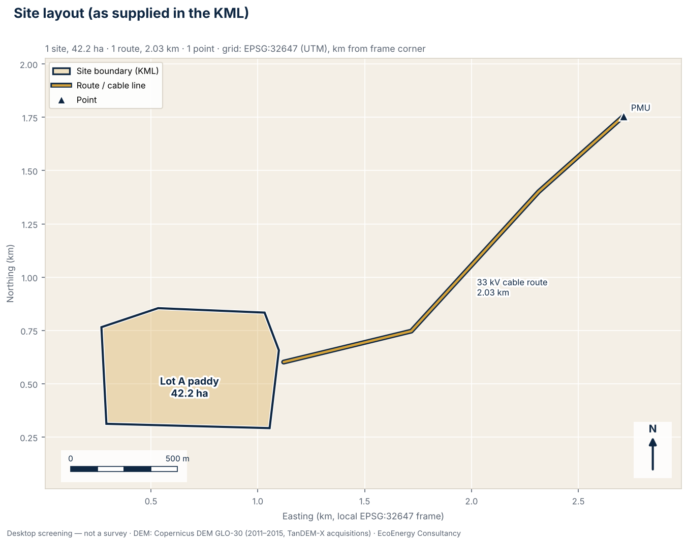
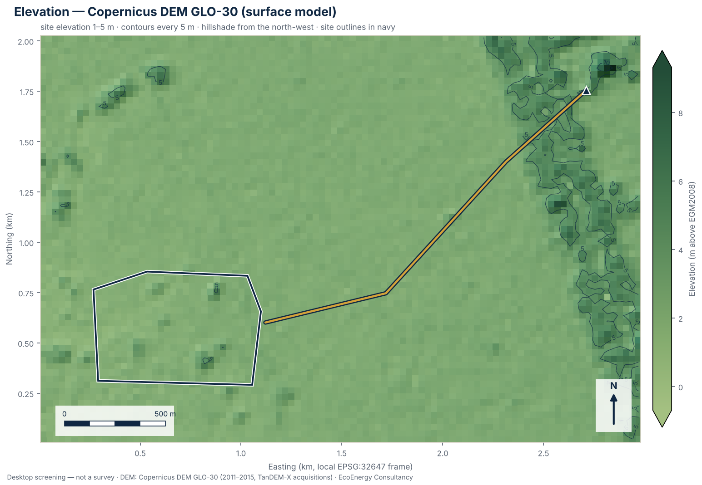
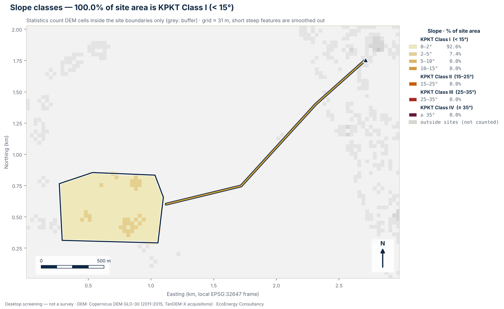
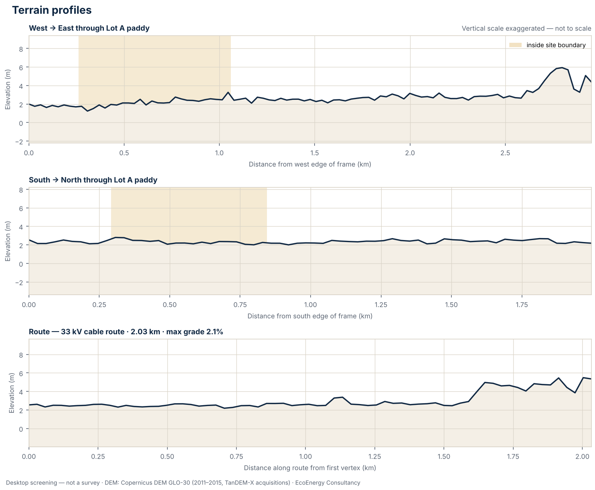

# Terrain screening summary

**Site:** Kota Setar paddy, Lot A

- Report: BEq\_flm-piWOPpdDonFm2w · generated 2026-10-13T01:36:22+00:00
- Input file: flat\_site\_kedah.kml (sha256 `045a5befe1ca93a2…`)
- Scheme: lss · stage: exploring
- Location: Kota Setar, Kedah (6.04221°N, 100.35545°E) · EPSG:32647
- DEM: Copernicus DEM GLO-30 — DSM (surface model: includes tree canopy and buildings); epoch 2011–2015 (TanDEM-X acquisitions); vertical datum EGM2008; nominal 30 m, analysed at 30.7 m (6,402 cells, 0.0% without data)

## Totals

- 1 site polygon(s), total 42.16 ha
- 1 route(s), total 2.03 km
- 1 point(s)
- KPKT split (area-weighted): Class I 100.0%, Class II 0.0%, Class III 0.0%, Class IV 0.0%
- Contour interval: 5.0 m

## Sites

| Site | Area (ha) | Elevation min–max (mean) m | Relief m | Slope mean / p90 / max ° | KPKT I / II / III / IV % | Cells |
|---|---:|---|---:|---|---|---:|
| Lot A paddy | 42.16 | 1.2–5.4 (2.4) | 4.2 | 0.7 / 1.6 / 3.9 | 100.0 / 0.0 / 0.0 / 0.0 | 445 |

Slope bins (% of site area):

| Site | 0-2 | 2-5 | 5-10 | 10-15 | 15-25 | 25-35 | \>35 |
|---|---:|---:|---:|---:|---:|---:|---:|
| Lot A paddy | 92.6 | 7.4 | 0.0 | 0.0 | 0.0 | 0.0 | 0.0 |

## Routes

| Route | Length km | Elevation min–max m | Total ascent m | Max grade % |
|---|---:|---|---:|---:|
| 33 kV cable route | 2.03 | 2.2–5.5 | 5.3 | 2.1 |

## Points

| Point | Lat | Lon | Elevation m |
|---|---:|---:|---:|
| PMU | 6.05290 | 100.37380 | 5.3 |

## Flags

- **INFO — Site area screens as KPKT Class I (below 15°).** No site has more than 0.5% of its area at 15° or steeper on this DEM, so the land screens as Class I, which the KPKT hill-land guidelines generally treat as developable. A 30 m elevation model smooths out short steep features such as bund faces, drain banks and cuttings, so a survey can still find locally steeper ground. *(Source: KPKT hill-land development guidelines (Garis Panduan Perancangan Pembangunan di Kawasan Bukit dan Tanah Tinggi))*
- **INFO — Route gradients.** Steepest gradient along each route, measured over at least 90 m — “33 kV cable route”: max grade 2.1% over 2.03 km (total climb 5 m). Short pitches at drains, embankments and road crossings can be steeper than a 30 m DEM shows.
- **INFO — Check EIA requirements for the total area.** Total polygon area is 42.16 ha. Whether an Environmental Impact Assessment is required depends on the activity and area categories in the schedules of the Environmental Quality (Prescribed Activities) (Environmental Impact Assessment) Order 2015, and on factors such as hill land, forest clearing or conversion of agricultural land. Have a qualified EIA consultant check the site against the current schedules. *(Source: Environmental Quality (Prescribed Activities) (Environmental Impact Assessment) Order 2015, under the Environmental Quality Act 1974)*

## Recommended follow-up studies

1. **Licensed topographic survey** — Before layout, earthworks or drainage design, commission a topographic survey by a licensed land surveyor (Licensed Land Surveyors Act 1958), or LiDAR / drone photogrammetry tied to surveyed ground control points.
2. **Geological map review (JMG)** — Review the Jabatan Mineral dan Geosains (JMG) geological map sheet for the site: formation, lithology and any karst or ex-mining ground that affects piling, anchoring or foundations.
3. **Rainfall and climate data (MET Malaysia)** — Obtain climate normals and rainfall records from the nearest MET Malaysia station; rainfall intensity feeds stormwater design to MSMA 2nd Edition.
4. **Surrounding land-use scan (1 / 5 / 10 km)** — Map settlements, schools, rivers and water intakes, forest reserves, industry and mining within 1 km, 5 km and 10 km of the site as context for EIA and SIA scoping.
5. **Land title, zoning and local authority requirements** — Confirm the land title, category of land use and any express conditions, the zoning in the local plan (Rancangan Tempatan), and the requirements of the local authority (PBT) for this type of development.
6. **Route wayleave and crossings** — Confirm land access and wayleaves along the cable or access route and identify road, river and railway crossings and TNB technical requirements; none of these show on an elevation model.

## Caveats

- Screening grade only: this is a desktop terrain screening from an open global elevation model, not a survey.
- The Copernicus DEM GLO-30 is a surface model: it records the top of tree canopy and buildings, not bare ground. Plantations, forest and built-up areas read higher than the ground beneath them, and slopes at their edges can be exaggerated.
- Elevations show the ground as it was in 2011–2015 (TanDEM-X acquisitions). Ponds, cuttings, platforms and buildings made since then are not represented.
- The nominal 30 m resolution (analysed at about 31 m) smooths out bunds, drains and short steep cuttings, so local slopes are underestimated.
- Site geometry is used exactly as supplied in the uploaded KML/KMZ file; it has not been checked against title plans or survey boundaries.
- Not for authority submissions or design: planning applications, earthworks, drainage and structural design need a licensed survey and qualified engineers.

## Figures

### Site layout

Site boundaries, routes and points as supplied in the KML, with areas in hectares, on a local UTM grid (EPSG:32647).

### Elevation and contours

Shaded Copernicus DEM GLO-30 surface elevation with contours every 5 m; tree canopy and buildings are included in the surface.

### Slope classes

Slope from the elevation model in seven bands, with the KPKT class boundaries at 15°, 25° and 35°; 100.0% of the site area is KPKT Class I (below 15°).

### Terrain profiles

West–east and south–north sections through “Lot A paddy”, plus the elevation profile along 1 route; the vertical scale is exaggerated and not to scale.

---

Copernicus DEM GLO-30 © DLR e.V. 2010–2014 and © Airbus Defence and Space GmbH 2014–2018, provided under COPERNICUS by the European Union and ESA; all rights reserved.  
Administrative boundaries: geoBoundaries (gbOpen) — states © OpenStreetMap contributors (ODbL 1.0); districts citypopulation.de (CC BY 3.0).
