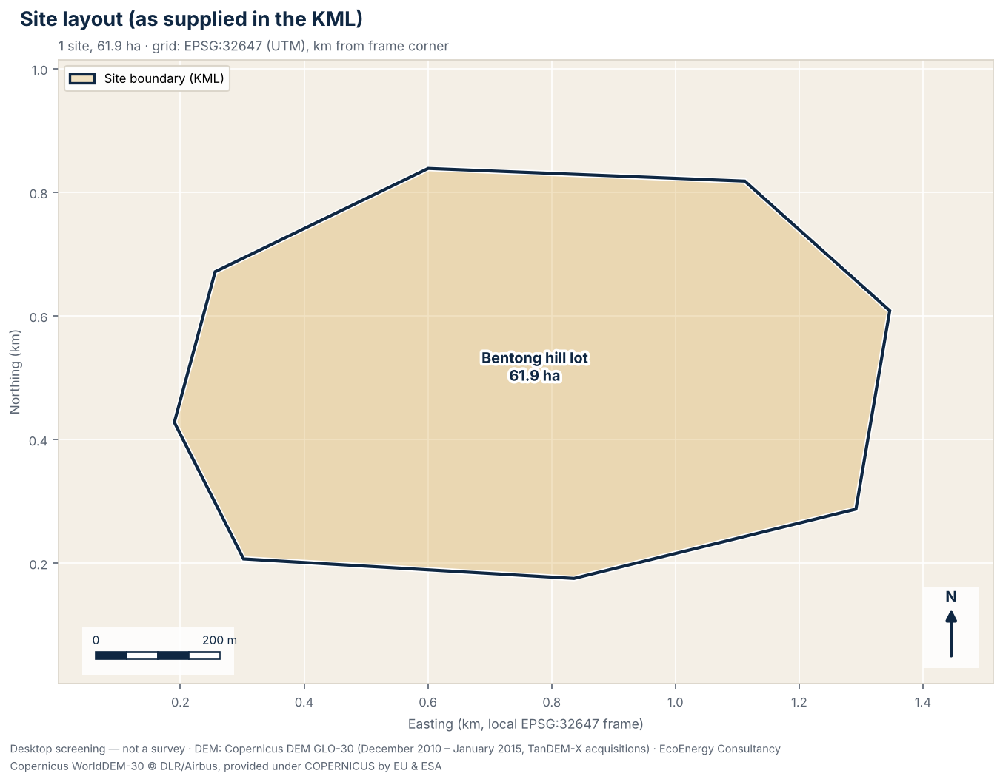
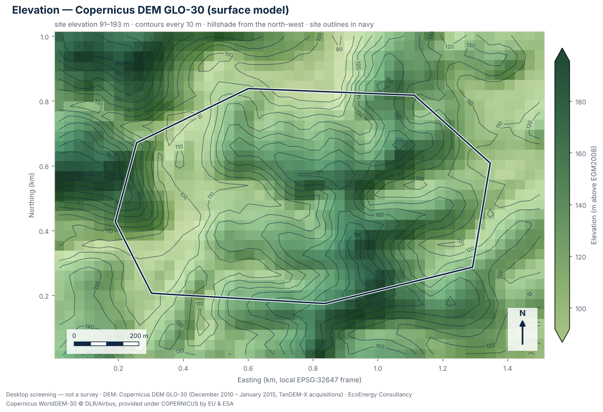
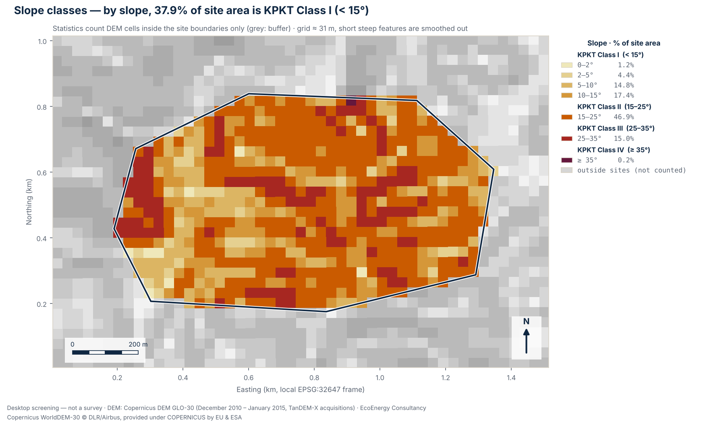
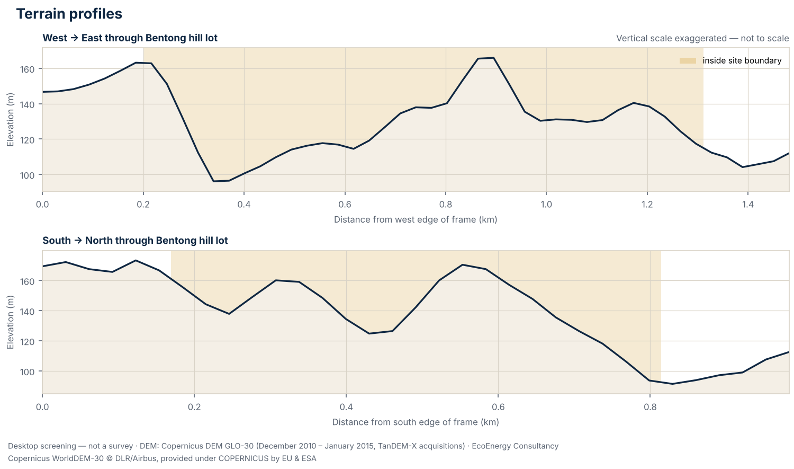

# Terrain screening summary

**Site:** Bentong hill lot

- Report: 6HQTpO2DAc32xrmWGCUJBw · generated 2026-10-13T02:08:38+00:00
- Input file: hilly\_site\_pahang.kml (sha256 `a376bb89e6a8980c…`)
- Scheme: lss · stage: land\_secured
- Location: Bentong, Pahang (3.50714°N, 101.90369°E) · EPSG:32647
- DEM: Copernicus DEM GLO-30 — DSM (surface model: includes tree canopy and buildings); epoch December 2010 – January 2015 (TanDEM-X acquisitions); vertical datum EGM2008; nominal 30 m, analysed at 30.8 m (1,617 cells, 0.0% without data)

## Totals

- 1 site polygon(s), total 61.86 ha
- 0 route(s), total 0.00 km
- 0 point(s)
- KPKT split (area-weighted): Class I 37.9%, Class II 46.9%, Class III 15.0%, Class IV 0.2%
- Contour interval: 10.0 m

## Sites

| Site | Area (ha) | Elevation min–max (mean) m | Relief m | Slope mean / p90 / max ° | KPKT I / II / III / IV % | Cells |
|---|---:|---|---:|---|---|---:|
| Bentong hill lot | 61.86 | 91.2–193.2 (134.5) | 102.0 | 17.1 / 26.7 / 37.0 | 37.9 / 46.9 / 15.0 / 0.2 | 654 |

Slope bins (% of site area):

| Site | 0-2 | 2-5 | 5-10 | 10-15 | 15-25 | 25-35 | \>35 |
|---|---:|---:|---:|---:|---:|---:|---:|
| Bentong hill lot | 1.2 | 4.4 | 14.8 | 17.4 | 46.9 | 15.0 | 0.2 |

## Flags

- **WARNING — Slopes of 25–35° inside the site (slope-based KPKT Class III).** Share of site area at 25° to under 35° on the DEM — “Bentong hill lot”: 15.0% of its area. Jadual 1 rates Class III as high geotechnical constraint. The class shown is a slope-based indication only: the guideline also assigns classes by geotechnical condition (signs of erosion or instability, colluvium or other sensitive geological material, ex-mining land), so a geotechnical assessment can place ground in a higher class. Below 300 m the guideline lists a narrower set of urban uses, at lower intensity, that may be considered on Class III ground; a solar farm is not among the uses it lists for any class. For Class III the guideline asks for an EIA report for all development projects. Leave this ground out of early layouts until a survey and a geotechnical assessment say otherwise. *(Source: PLANMalaysia (then JPBD Semenanjung Malaysia, KPKT), Garis Panduan Perancangan Pembangunan di Kawasan Bukit dan Tanah Tinggi (2009), Jadual 1)*
- **WARNING — Pahang solar guideline: terrain steeper than 10° is not suitable.** Share of site area steeper than 10° on the DEM — “Bentong hill lot”: 79.5%. PLANMalaysia@Pahang's solar planning guideline (GPP PHG 03, 2022) says solar farms suit flat and gently sloping land, that terrain steeper than 10 degrees is not suitable (“Keadaan topografi yang berkecerunan melebihi 10 darjah adalah tidak sesuai”), and that site clearing and earthworks must be kept to a minimum. Because part of the site is at 25° or steeper on the DEM, note also Pahang's Kaedah-Kaedah Kawalan Perancangan (Pemajuan Tanah Bukit, Tanah Tinggi dan Lereng Bukit)(Pahang) 2019: urban development applications (housing, commercial, tourism and industrial) on highland at 300 m or more, or on slopes of 25° or more, are reviewed by the state KSAS Technical Committee (JTKSAS); different criteria apply in Cameron Highlands, Genting Highlands, Bukit Tinggi and Janda Baik. *(Source: PLANMalaysia@Pahang, Garis Panduan Perancangan Pembangunan Tenaga Solar Negeri Pahang (GPP PHG 03, 2022); Kaedah-Kaedah Kawalan Perancangan (Pemajuan Tanah Bukit, Tanah Tinggi dan Lereng Bukit)(Pahang) 2019, as summarised in PLANMalaysia@Pahang's JTKSAS monograph (2022 edition))*
- **WARNING — EIA Order 2015 slope item: ground at 25–35°.** Share of site area at 25° to under 35° on the DEM — “Bentong hill lot”: 15.0% of its area (under 50%, which points to First Schedule item 13). The EIA Order 2015 lists “development or land clearing less than 50 per cent of an area with slope greater than or equal to 25° but less than 35°” in the First Schedule (item 13), and “development or land clearing of 50 per cent or more” of such an area in the Second Schedule (item 13(a)), which also requires public display and public comment. The item sets no minimum area. A 30 m DEM understates slopes, so the true share at 25–35° may be higher. Have a DOE-registered EIA consultant confirm how the item applies to the planned layout. *(Source: Environmental Quality (Prescribed Activities) (Environmental Impact Assessment) Order 2015, P.U. (A) 195/2015, First Schedule item 13 and Second Schedule item 13(a))*
- **CAUTION — Slopes of 15–25° inside the site (slope-based KPKT Class II).** Share of site area at 15° to under 25° on the DEM — “Bentong hill lot”: 46.9% of its area. Jadual 1 rates Class II as moderate geotechnical constraint. The class shown is a slope-based indication only: the guideline also assigns classes by geotechnical condition (signs of erosion or instability, colluvium or other sensitive geological material, ex-mining land), so a geotechnical assessment can place ground in a higher class. Below 300 m the guideline lists urban uses that may be considered on Class II ground, with intensity limits; a solar farm is not among the uses it lists for any class, so ask the local planning authority how it will treat one here. *(Source: PLANMalaysia (then JPBD Semenanjung Malaysia, KPKT), Garis Panduan Perancangan Pembangunan di Kawasan Bukit dan Tanah Tinggi (2009), Jadual 1)*
- **CAUTION — Hill land elevation band (Tanah Bukit, 150–300 m).** Highest DEM elevation — “Bentong hill lot”: up to 193 m (lowest 91 m). The 2009 hill and highland guideline treats land at 150–300 m above sea level as Tanah Bukit (hill land) and, quoting the National Physical Plan, places it in KSAS Level 3: controlled development, with the type and intensity of development set by site constraints. The DEM is a surface model, so under tree canopy or buildings the ground is lower than shown; check the band against surveyed levels. *(Source: PLANMalaysia (then JPBD Semenanjung Malaysia, KPKT), Garis Panduan Perancangan Pembangunan di Kawasan Bukit dan Tanah Tinggi (2009), s.2 land categories and KSAS levels quoted from National Physical Plan Policy 18)*
- **CAUTION — Act 133 geotechnical report for slopes over 25° and 10 m high.** On the DEM — “Bentong hill lot”: 15.2% of its area steeper than 25°, 102 m of relief. Section 70(2)(c) of the Street, Drainage and Building Act 1974 (Act 133), inserted by Act A1588 (2019), requires a geotechnical report, verified by an Accredited Checker, for “erection involving slope with a gradient more than twenty-five degrees and total vertical height more than ten metres”. The 25° and 10 m tests apply to an individual slope; site relief only shows that slopes of that height may exist. Check with the local authority whether the provision applies and is in force for this area. *(Source: Street, Drainage and Building Act 1974 (Act 133), s.70(2)(c), inserted by Act A1588 (2019))*
- **CAUTION — More than 10% of a site is steeper than about 8.5° (15% grade).** Share of site area steeper than about 8.5° (a 15% grade) and steeper than about 5.7° (a 10% grade) on the DEM — “Bentong hill lot”: 85% and 92%. IFC's 2015 solar developer guide (s.6.3.4) says a site should ideally be flat or on a slight south-facing slope (northern hemisphere) and that mounting structures can be designed for most locations at extra cost and complexity; it gives no numeric limit. For context, published product figures include a standard north–south slope tolerance of 15% for two single-axis trackers (Array Technologies DuraTrack HZ v3, with 26% as an option; TrinaTracker Vanguard 1P, also 15% east–west) and standard conditions up to 10% for one fixed-tilt structure (TrinaTracker FixOrigin); NREL's 2024 US supply-curve study excludes slopes over 10% in its Reference scenario (5% in its Limited scenario). These figures do not show whether any product suits this site: tolerances depend on the slope direction relative to the rows and must come from the chosen supplier. This ground may need grading, terracing or special piling, adding earthworks and erosion-control cost. *(Source: IFC (2015) Utility-Scale Solar Photovoltaic Power Plants: A Project Developer's Guide, s.6.3.4; Array Technologies DuraTrack HZ v3 and TrinaTracker Vanguard 1P datasheets; TrinaTracker FixOrigin brochure; NREL/TP-6A20-91900 (2024))*
- **INFO — Technical reports asked for under the hill and highland guideline.** Listed because part of the site is at 15° or steeper on the DEM and the site reaches 150 m or more on the DEM. Where the 2009 hill and highland guideline applies, it asks for five technical reports for every slope class: (1) a geotechnical investigation and slope stability analysis by a geotechnical engineer; (2) geological and geomorphological mapping by a geologist registered with the Board of Geologists; (3) a drainage report under MSMA by a hydrology engineer registered with JPS; (4) an EIA report by a DOE-registered EIA consultant (the Class I and II pages add “for development over 50 hectares”; for Class III the guideline asks for an EIA for all development projects and for Class IV a detailed EIA); and (5) an earthworks plan by an engineer registered with BEM. *(Source: PLANMalaysia (then JPBD Semenanjung Malaysia, KPKT), Garis Panduan Perancangan Pembangunan di Kawasan Bukit dan Tanah Tinggi (2009), Jadual 1 (technical reports for every class))*
- **INFO — Indicative gross capacity from site area.** Using IFC (2015) Table 7, about 0.8–1.2 ha per MWp for crystalline-silicon ground-mounted PV in Thailand and Indonesia (the closest climates listed): the total polygon area of 61.86 ha gives about 52–77 MWp; the 9.2 ha flatter than about 8.5° (15% grade) on the DEM gives about 7.6–11.4 MWp. These are gross figures, before setbacks, access roads, drainage reserves, shading, steep or unsuitable ground and grid limits; the exact area per MWp varies with the tilt angle and row spacing (pitch). *(Source: IFC (2015) Utility-Scale Solar Photovoltaic Power Plants: A Project Developer's Guide, Table 7)*
- **INFO — More than 30 m of elevation change within a site.** Elevation range (highest minus lowest point) — “Bentong hill lot”: 102 m. Plan for an earthworks balance and for stormwater and erosion control designed to MSMA 2nd Edition (DID/JPS 2012) at design stage, and allow for them in early cost estimates. *(Source: Urban Stormwater Management Manual for Malaysia (MSMA), 2nd Edition (DID/JPS 2012))*
- **INFO — EIA Order 2015: area-based items to check.** Solar PV is not listed among the power-generation items of the EIA Order 2015 at any capacity. Area-based items may still apply, depending on the land cover and what is cleared, converted or drained: First Schedule 5(a), conversion of forest at 300 m or more above mean sea level to other land use, 20 ha to under 100 ha (Second Schedule 5(a): 100 ha or more); First Schedule 5(d), conversion of mangrove, peat swamp or freshwater swamp forest for industrial, housing or agricultural use, 20 ha to under 50 ha (Second Schedule 5(f): 50 ha or more); Second Schedule 3(b), drainage of wetland, wildlife habitat or dry inland forest covering 20 ha or more; First Schedule 17, development of an industrial estate of 20 ha or more — whether DOE treats a solar farm as an industrial estate is not settled. Pahang's solar planning guideline describes a solar farm as an industrial activity, but that is not a DOE ruling. The total polygon area is 61.86 ha; the thresholds apply to the area actually cleared, converted or drained. Second Schedule activities also require public display and public comment. Have a DOE-registered EIA consultant confirm which items apply. *(Source: Environmental Quality (Prescribed Activities) (Environmental Impact Assessment) Order 2015, P.U. (A) 195/2015, First Schedule items 5(a), 5(d) and 17; Second Schedule items 3(b), 5(a) and 5(f); item 11 (power generation))*

## Recommended follow-up studies

1. **Licensed topographic survey** — Before layout, earthworks or drainage design, commission a topographic survey by a licensed land surveyor (Licensed Land Surveyors Act 1958, Act 458), or LiDAR / drone photogrammetry tied to surveyed ground control points.
2. **Geological map review (JMG)** — Review the Jabatan Mineral dan Geosains (JMG) geological map sheet for the site: formation, lithology and any karst or ex-mining ground that affects piling, anchoring or foundations.
3. **Rainfall and climate data (MET Malaysia)** — Obtain climate normals and rainfall records from the nearest MET Malaysia station; rainfall intensity feeds stormwater design to MSMA 2nd Edition.
4. **Surrounding land-use scan (1 / 5 / 10 km)** — Map settlements, schools, rivers and water intakes, forest reserves, industry and mining within 1 km, 5 km and 10 km of the site as context for EIA and SIA scoping.
5. **Land title, zoning and local authority requirements** — Confirm the land title, category of land use and any express conditions, the zoning in the local plan (Rancangan Tempatan), and the requirements of the local authority (PBT) for this type of development.
6. **Geotechnical investigation and slope stability analysis** — Commission a geotechnical investigation and slope stability analysis by a geotechnical engineer before any layout or earthworks decision; the hill and highland guideline asks for it for every slope class. Where Act 133 s.70(2)(c) applies (a slope steeper than 25° and more than 10 m high), the geotechnical report must be verified by an Accredited Checker.
7. **Geological and geomorphological mapping** — Commission geological and geomorphological mapping by a geologist registered with the Board of Geologists, as the guideline asks; it also identifies colluvium, ex-mining ground and other conditions that can put ground in a higher KPKT class than its slope suggests.
8. **Drainage report to MSMA** — Have a hydrology engineer registered with JPS prepare the drainage and stormwater report to MSMA 2nd Edition (DID/JPS 2012), including erosion and sediment control during earthworks.
9. **Earthworks plan** — Have an engineer registered with BEM prepare the earthworks plan. The guideline keeps hill cutting to a minimum and does not allow cutting hills to level a whole development site.
10. **Confirm EIA applicability with a DOE-registered EIA consultant** — Have a DOE-registered EIA consultant check the layout, land cover and areas to be cleared against the First and Second Schedules of the EIA Order 2015 (in Sabah and Sarawak, against the state's requirements) before committing to the site.

## Caveats

- Screening grade only: this is a desktop terrain screening from an open global elevation model. It is not a survey under the Licensed Land Surveyors Act 1958 (Act 458), not engineering design, and not for planning applications or any other authority submission.
- The Copernicus DEM GLO-30 is a digital surface model (DSM): vegetation and buildings were not removed, so plantations, forest and built-up areas read higher than the ground beneath them, and slopes at their edges can be exaggerated. Water bodies were flattened during editing, so over water it shows a level surface and nothing about depth.
- Accuracy: the Copernicus DEM specification is an absolute vertical accuracy better than 4 m and a relative vertical accuracy better than 2 m on slopes up to 20% (4 m on steeper slopes), both as 90% linear error (LE90). Independent checks are weaker under forest: in a global study against ICESat-2 ground heights where canopy cover exceeded 50%, 90% of errors were within 26.55 m and the mean error was +12.09 m, so the model read high (Hawker et al. 2022, Environ. Res. Lett. 17 024016). Against 38 GNSS benchmarks in Perlis, Malaysia, its RMSE was 2.45 m (Sibaruddin et al. 2026).
- Elevations show the surface as it was in December 2010 – January 2015 (TanDEM-X acquisitions). Ponds, cuttings, platforms and buildings made since then are not represented.
- Slopes are computed on a grid of about 31 m (nominal 30 m resolution). Each slope value averages over neighbouring cells, so short steep features such as bund faces, drain banks, stream banks and cuttings are smoothed out, and the shares of ground steeper than 15°, 25° and 35° are likely to be understated.
- Contours are drawn every 10 m; this tool never draws them finer than 5 m. The ASPRS Positional Accuracy Standards (2014, repeated in 2023) relate a contour interval to digital elevation data as twice the 90% vertical error (LE90); with the specified relative LE90 of under 2 m on slopes up to 20%, that is up to about 4 m, so 5 m is the finest honest interval for this model. Contours are for context, not design.
- Slope direction (aspect) is not assessed. At Malaysian latitudes (about 1–7°N) it is secondary to earthworks, drainage and geotechnics: the Global Solar Atlas gives optimum fixed tilts of only 2–8° at four sample points across Malaysia, gaining under 1% over horizontal. IFC (2015, s.6.3.4) says a site should ideally be flat or on a slight south-facing slope in the northern hemisphere.
- State and district come from DOSM boundaries at the centroid of the uploaded features and are for orientation; the state-specific notes depend on that lookup. Local authority areas, Special Management Areas, forest reserves and land titles are not checked.
- Regulatory notes summarise published instruments and, where marked, news reports. They are a screening aid, not legal advice; requirements change and are applied by the relevant authorities, so confirm them before relying on them.
- Site geometry is used exactly as supplied in the uploaded KML/KMZ file; it has not been checked against title plans or survey boundaries.

## Figures

### Site layout

Site boundaries, routes and points as supplied in the KML, with areas in hectares, on a local UTM grid (EPSG:32647).

### Elevation and contours

Shaded Copernicus DEM GLO-30 elevation with contours every 10 m; tree canopy and buildings are included in the surface.

### Slope classes

Slope from the elevation model in seven bands, with the KPKT slope-class boundaries at 15°, 25° and 35°; by slope alone, 37.9% of the site area is Class I (below 15°).

### Terrain profiles

West–east and south–north sections through “Bentong hill lot”; the vertical scale is exaggerated and not to scale.

---

Produced using Copernicus WorldDEM-30 © DLR e.V. 2010-2014 and © Airbus Defence and Space GmbH 2014-2018 provided under COPERNICUS by the European Union and ESA; all rights reserved.  
The organisations in charge of the Copernicus programme by law or by delegation do not incur any liability for any use of the Copernicus WorldDEM-30.  
State and district boundaries: Department of Statistics Malaysia (DOSM) open data (github.com/dosm-malaysia/data-open), used under the DOSM Open Data Licence. No endorsement by DOSM is implied.
