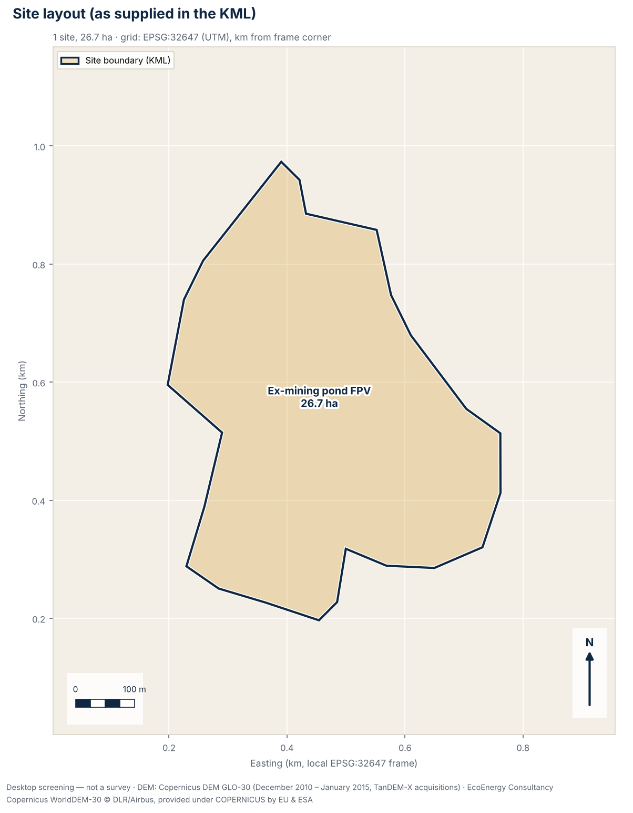
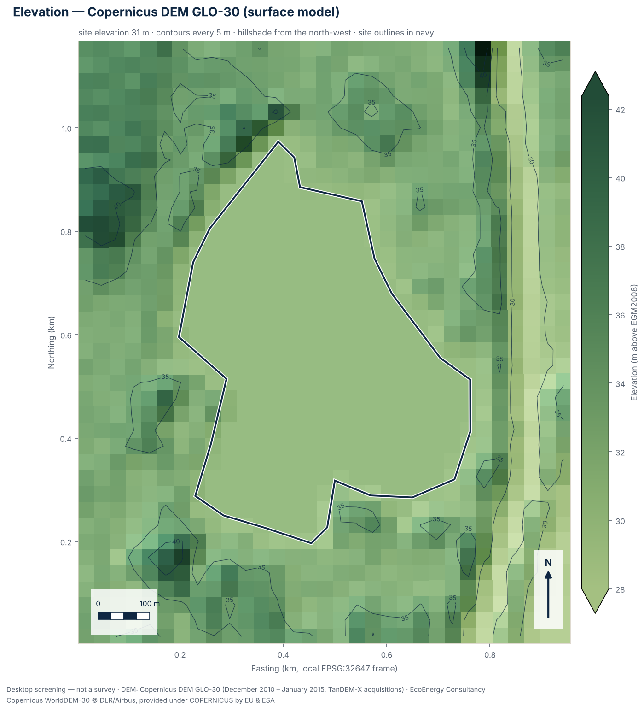
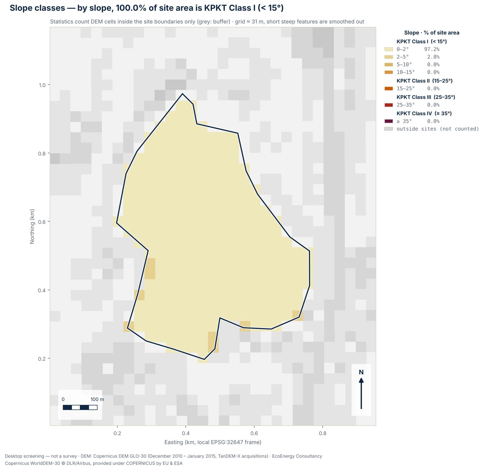
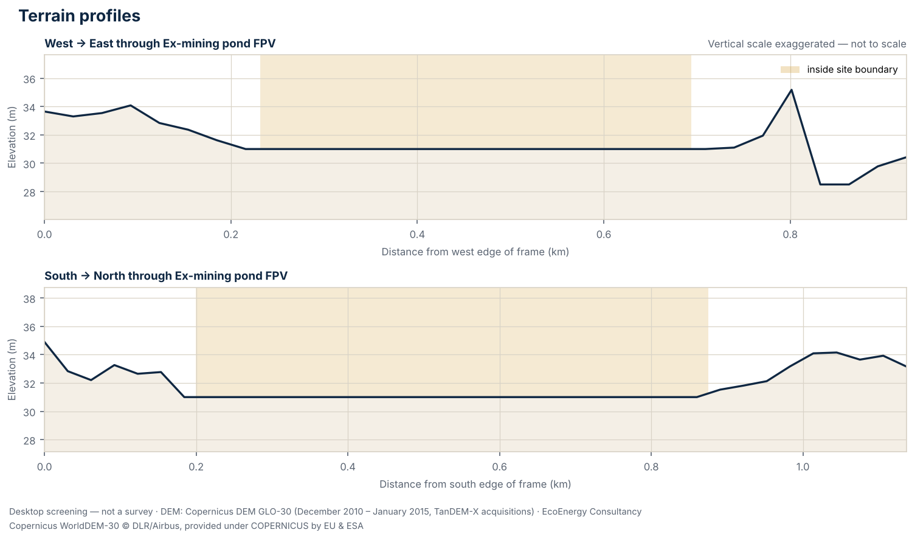

# Terrain screening summary

**Site:** Kinta ex-mining pond

- Report: 9paUBr\_E508F3I81xTr0pA · generated 2026-10-13T06:50:40+00:00
- Input file: fpv\_pond\_perak.kml (sha256 `227baed790f6008c…`)
- Scheme: fpv · stage: bidding
- Location: Kinta, Perak (4.54730°N, 101.05758°E) · EPSG:32647
- DEM: Copernicus DEM GLO-30 — DSM (surface model: includes tree canopy and buildings); epoch December 2010 – January 2015 (TanDEM-X acquisitions); vertical datum EGM2008; nominal 30 m, analysed at 30.8 m (1,178 cells, 0.0% without data)

## Totals

- 1 site polygon(s), total 26.69 ha
- 0 route(s), total 0.00 km
- 0 point(s)
- KPKT split (all sites, overlaps counted once): Class I 100.0%, Class II 0.0%, Class III 0.0%, Class IV 0.0%
- Contour interval: 5.0 m

## Sites

| Site | Area (ha) | Elevation min–max (mean) m | Relief m | Slope mean / p90 / max ° | KPKT I / II / III / IV % | Cells |
|---|---:|---|---:|---|---|---:|
| Ex-mining pond FPV | 26.69 | 31.0–31.0 (31.0) | 0.0 | 0.1 / 0.0 / 4.2 | 100.0 / 0.0 / 0.0 / 0.0 | 286 |

Slope bins (% of site area):

| Site | 0-2 | 2-5 | 5-10 | 10-15 | 15-25 | 25-35 | \>35 |
|---|---:|---:|---:|---:|---:|---:|---:|
| Ex-mining pond FPV | 97.2 | 2.8 | 0.0 | 0.0 | 0.0 | 0.0 | 0.0 |

## Flags

- **INFO — The elevation model cannot see the pond bed.** The Copernicus DEM GLO-30 was acquired in December 2010 – January 2015 (TanDEM-X acquisitions). Ponds excavated or flooded after that do not appear in it. Where water was present it records the water surface, not the bed, and water bodies were flattened during editing, so it says nothing about depth; the slope and KPKT figures for a pond therefore describe its water surface only. For floating solar, a bathymetric survey, seasonal water-level records and the condition of the bunds govern the design — no elevation model provides them.
- **INFO — EIA Order 2015: area-based items to check.** Solar PV is not listed among the power-generation items of the EIA Order 2015 at any capacity. Area-based items may still apply, depending on the land cover and what is cleared, converted or drained: First Schedule 5(a), conversion of forest at 300 m or more above mean sea level to other land use, 20 ha to under 100 ha (Second Schedule 5(a): 100 ha or more); First Schedule 5(d), conversion of mangrove, peat swamp or freshwater swamp forest for industrial, housing or agricultural use, 20 ha to under 50 ha (Second Schedule 5(f): 50 ha or more); Second Schedule 3(b), drainage of wetland, wildlife habitat or dry inland forest covering 20 ha or more; First Schedule 17, development of an industrial estate of 20 ha or more — whether DOE treats a solar farm as an industrial estate is not settled. The total polygon area is 26.69 ha; the thresholds apply to the area actually cleared, converted or drained. Second Schedule activities also require public display and public comment. Have a DOE-registered EIA consultant confirm which items apply. *(Source: Environmental Quality (Prescribed Activities) (Environmental Impact Assessment) Order 2015, P.U. (A) 195/2015, First Schedule items 5(a), 5(d) and 17; Second Schedule items 3(b), 5(a) and 5(f); item 11 (power generation))*

## Recommended follow-up studies

1. **Licensed topographic survey** — Before layout, earthworks or drainage design, commission a topographic survey by a licensed land surveyor (Licensed Land Surveyors Act 1958, Act 458), or LiDAR / drone photogrammetry tied to surveyed ground control points.
2. **Geological map review (JMG)** — Review the Jabatan Mineral dan Geosains (JMG) geological map sheet for the site: formation, lithology and any karst or ex-mining ground that affects piling, anchoring or foundations.
3. **Rainfall and climate data (MET Malaysia)** — Obtain climate normals and rainfall records from the nearest MET Malaysia station; rainfall intensity feeds stormwater design to MSMA 2nd Edition.
4. **Surrounding land-use scan (1 / 5 / 10 km)** — Map settlements, schools, rivers and water intakes, forest reserves, industry and mining within 1 km, 5 km and 10 km of the site as context for EIA and SIA scoping.
5. **Land title, zoning and local authority requirements** — Confirm the land title, category of land use and any express conditions, the zoning in the local plan (Rancangan Tempatan), and the requirements of the local authority (PBT) for this type of development.
6. **Confirm EIA applicability with a DOE-registered EIA consultant** — Have a DOE-registered EIA consultant check the layout, land cover and areas to be cleared against the First and Second Schedules of the EIA Order 2015 (in Sabah and Sarawak, against the state's requirements) before committing to the site.
7. **Bathymetric survey** — Survey water depth across the pond to design anchoring and mooring and to confirm the usable water area.
8. **Seasonal water-level records** — Obtain or start recording water levels through wet and dry seasons; the drawdown range sets mooring load cases and the risk of panels grounding.
9. **Bund geotechnical assessment** — Have the bunds and embankments assessed by a geotechnical engineer, especially for ex-mining ponds, including the consequence of a bund failure.

## Caveats

- Screening grade only: this is a desktop terrain screening from an open global elevation model. It is not a survey under the Licensed Land Surveyors Act 1958 (Act 458), not engineering design, and not for planning applications or any other authority submission.
- The Copernicus DEM GLO-30 is a digital surface model (DSM): vegetation and buildings were not removed, so plantations, forest and built-up areas read higher than the ground beneath them, and slopes at their edges can be exaggerated. Water bodies were flattened during editing, so over water it shows a level surface and nothing about depth.
- Accuracy: the Copernicus DEM specification is an absolute vertical accuracy better than 4 m and a relative vertical accuracy better than 2 m on slopes up to 20% (4 m on steeper slopes), both as 90% linear error (LE90). Independent checks are weaker under forest: in a global study against ICESat-2 ground heights where canopy cover exceeded 50%, 90% of errors were within 26.55 m and the mean error was +12.09 m, so the model read high (Hawker et al. 2022, Environ. Res. Lett. 17 024016). Against 38 GNSS benchmarks in Perlis, Malaysia, its RMSE was 2.45 m (Sibaruddin et al. 2026).
- Elevations show the surface as it was in December 2010 – January 2015 (TanDEM-X acquisitions). Ponds, cuttings, platforms and buildings made since then are not represented.
- Slopes are computed on a grid of about 31 m (nominal 30 m resolution). Each slope value averages over neighbouring cells, so short steep features such as bund faces, drain banks, stream banks and cuttings are smoothed out, and the shares of ground steeper than 15°, 25° and 35° are likely to be understated.
- Contours are drawn every 5 m. The ASPRS Positional Accuracy Standards (2014, repeated in 2023) relate a contour interval to digital elevation data as twice the 90% vertical error (LE90) against true ground; with the specified absolute LE90 of under 4 m that corresponds to about 8 m, and far coarser under forest canopy. Contours are drawn for context only and are not to a mapping standard.
- Slope direction (aspect) is not assessed. At Malaysian latitudes (about 1–7°N) it is secondary to earthworks, drainage and geotechnics: the Global Solar Atlas gives optimum fixed tilts of only 2–8° at four sample points across Malaysia, gaining under 1% over horizontal. IFC (2015, s.6.3.4) says a site should ideally be flat or on a slight south-facing slope in the northern hemisphere.
- State and district come from DOSM boundaries at the centroid of the uploaded features and are for orientation; the state-specific notes depend on that lookup. Local authority areas, Special Management Areas, forest reserves and land titles are not checked.
- Regulatory notes summarise published instruments and, where marked, news reports. They are a screening aid, not legal advice; requirements change and are applied by the relevant authorities, so confirm them before relying on them.
- Site geometry is used exactly as supplied in the uploaded KML/KMZ file; it has not been checked against title plans or survey boundaries.

## Figures

### Site layout

Site boundaries, routes and points as supplied in the KML, with areas in hectares, on a local UTM grid (EPSG:32647).

### Elevation and contours

Shaded Copernicus DEM GLO-30 elevation with contours every 5 m; tree canopy and buildings are included in the surface.

### Slope classes

Slope from the elevation model in seven bands, with the KPKT slope-class boundaries at 15°, 25° and 35°; by slope alone, 100.0% of the site area is Class I (below 15°).

### Terrain profiles

West–east and south–north sections through “Ex-mining pond FPV”; the vertical scale is exaggerated and not to scale.

---

Produced using Copernicus WorldDEM-30 © DLR e.V. 2010-2014 and © Airbus Defence and Space GmbH 2014-2018 provided under COPERNICUS by the European Union and ESA; all rights reserved.  
The organisations in charge of the Copernicus programme by law or by delegation do not incur any liability for any use of the Copernicus WorldDEM-30.  
State and district boundaries: Department of Statistics Malaysia (DOSM) open data (github.com/dosm-malaysia/data-open), used under the DOSM Open Data Licence. No endorsement by DOSM is implied.
